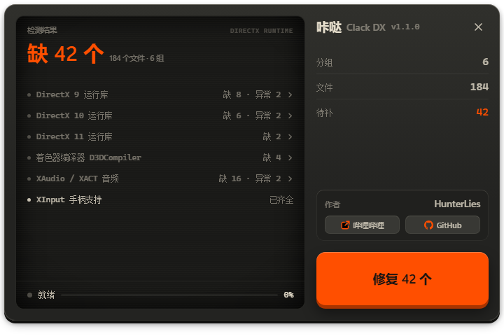

<p align="center">
  
</p>

<h1 align="center">咔哒 DX / Clack DX</h1>

<p align="center">Windows 单文件 DirectX 运行库修复</p>

<p align="center">
  
  
</p>

<table>
<tr>
<td width="230" valign="top"></td>
<td valign="top">

补齐系统里缺的 DirectX 运行库文件。游戏报 `缺少 d3dx9_43.dll`、`缺少 XINPUT1_3.dll`、`找不到 d3dx11_43.dll`，都是这个。

六个分组共 184 个文件：DirectX 9 / 10 / 11、着色器编译器、XAudio / XACT 音频、XInput 手柄。

x86 装进 `SysWOW64`（32 位游戏读这里），x64 装进 `System32`。

缺失的补上；**存在但被改坏、被截断、或被换成旧版的，也会认出来并修好**。版本不低于 payload 的一律不动（绝不降级）。

**只动 DirectX 的 dll，不碰 VC++ 运行库**——那归[咔哒 / Clack](https://github.com/Hunter-Lies/clack) 管。

全程离线，不驻留、不自启、不注册服务。

</td>
</tr>
</table>

## 用法

从 [Releases](../../releases) 下 `ClackDX-1.1.1-x64.exe`，双击，过 UAC：

1. 点「检测」——屏幕会逐文件过一遍，跑完列出六组各缺几个、有几个不对
2. 想细看就点那一行，展开是这一组有问题的文件名（带 32/64 标记），异常项还会写明原因（`0 字节`、`版本 x < y`）
3. 点「修复 N 个」，补完屏幕打勾，按「完成」收工

## 系统改动

| 位置 | 内容 |
|---|---|
| `C:\Windows\SysWOW64`、`C:\Windows\System32` | 补进去的 DX dll，只补缺的 |
| `C:\ProgramData\ClackDX\payload\<版本>\` | 解出来的 184 个 dll，约 222 MB；只在运行期间存在，关掉窗口自动删 |
| `%TEMP%\ClackDX.log` | 运行日志，每次启动重写一份 |

程序退出时会清掉那 222 MB。只有被任务管理器强杀（或崩溃）时才可能留下
`C:\ProgramData\ClackDX\`，手动删掉即可。

清理：删 exe。补进系统目录的那些文件不建议手动删——删了游戏又会缺，
而它们本来就是微软的可再发行组件，留着是对的。

## 问题

- **提示"已保护你的电脑"**<br>没买代码签名证书，点「更多信息」→「仍要运行」
- **要重启吗**<br>不用
- **修复中关不掉窗口**<br>故意的，真卡死用任务管理器结束进程，再看 `%TEMP%\ClackDX.log`
- **系统要求**<br>Windows 10 / 11 x64，界面走 WebView2
- **有个文件没补上**<br>多半是它正被别的程序占用，关掉那个程序（尤其是正在运行的游戏）再点一次
- **怎么修都不对劲**<br>用 `ClackDX-1.1.1-x64.exe --verify-hash` 启动：它会额外把 payload 里的文件和系统里那份**逐字节**比一遍，抓出"版本和大小都对、内容却坏了"的静默损坏

## 构建

需要 Node 20+、pnpm、Rust（含 MSVC 工具链）、7-Zip。

```powershell
# DirectX 分发包放 _work\dxredist\，不给就自己从微软官网下（约 100 MB）
.\tools\stage_payload.ps1     # 解 154 个 cab → _work\payload
.\make_release.ps1            # 出单文件 exe，产物在 out\

cd ui ; pnpm install ; pnpm tauri dev     # 开发调试
```

发布前跑 `tools\check_deps.ps1`（exe 不依赖 VC++ 运行库）和 `tools\check_repo.ps1`（仓库无本机痕迹）。

分组表在 [ui/src-tauri/src/lib.rs](ui/src-tauri/src/lib.rs) 的 `GROUPS`；184 个文件的来源与 SHA256 在 [docs/组件来源与校验.md](docs/组件来源与校验.md)。

## 框架

Tauri 2 + Rust 后端，WebView2 承载 Vue 3 界面，Vite 构建：Tauri `2.12.4`（MIT / Apache-2.0）、Vue `3.5.43`（MIT）、Vite `8.3.4`（MIT，仅构建期）。许可详见 [THIRD-PARTY.md](THIRD-PARTY.md)。

## 许可

本仓库代码采用 [CC BY-NC-SA 4.0](LICENSE)：署名、非商业、相同方式共享。

注意这是**源码公开**，不是 OSI 认可的开源许可——非商业性使用这条限制，让它不符合开源定义。

图标取自 [Lucide](https://lucide.dev)（ISC）；补进系统的那些 dll 版权归 Microsoft，不在本仓库里。
